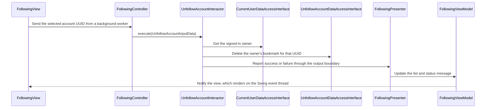

# Workout Manager

## Team Information

### Team Members
- Jirat
- Demeng
- Eric
- David
- Amgalan

---

## Project Description

### Domain

A workout companion app for planning and logging exercise, with private bookmarks for accounts you follow.

---

## User Stories

### User Story 1

As a user, I want to register my account so that I can start using the app.

### User Story 2

As a beginner, I want to be able to search exercises by filters so I can find exercises I didn't know existed.

### User Story 3

As a regular user, I want to create a workout plan so I don't have to log the same exercises every time.

### User Story 4

As a user, I want to be able to edit my workout plan so I don't have to create a new one each time.

### User Story 5

As a user, I want to log my exercises to track my progress and look at my history.

### User Story 6

As a user, I want to see my history and personal records so I can see my own growth and feel motivated to keep working out.

### User Story 7

As a signed-in user, I want to follow accounts by username and remove bookmarks I no longer need so I can keep a private Following list of accounts I want to find again.

### User Story 8

*Planned.* As a user, I want to be able to respond to friend requests so I can choose whether I want to stay in touch or not.

### User Story 9

*Planned.* As a user, I want to copy my friend's workout plans so I can do the same exercises as my friends.

### User Story 10

As a user, I want to change my password and other account settings so that my account stays up to date.

---

## Use Cases

### Register an Account

**Actor:** New user. **Precondition:** Signed out. **Trigger:** The user opens registration.

**Success outcome:** The account and profile are saved, and the user is signed in on Home.

1. The user submits an email address, username, display name, password, and password confirmation.
2. The system validates the details and creates the account.
3. The system loads the profile and opens Home.

**Extensions:**
- At step 2, if a detail is rejected, the system explains why and the user corrects it.
- At step 2, if the system can't tell whether the account was created, it suggests logging in first in case the account already exists.
- At step 3, if the profile can't be loaded or the email address needs confirming, the user stays signed out and can log in later.

### Log In

**Actor:** Registered user. **Precondition:** Signed out. **Trigger:** The user submits their login details.

**Success outcome:** The user is signed in and sees Home.

1. The user provides their email address and password.
2. The system verifies the credentials and loads the profile.
3. Home shows the user's display name and username.

**Extensions:** At step 2, invalid credentials, pending email confirmation, or a service failure leave the user signed out. The app explains what they can try next.

### Log Out

**Actor:** Signed-in user. **Precondition:** Home is open. **Trigger:** The user selects Log Out.

**Success outcome:** The user is signed out and sees Log In.

1. The system signs the user out and removes their details from the screen.
2. The system returns to Log In and confirms that the user is signed out.

**Extension:** At step 1, if the account service can't be reached, the user is still signed out on this computer.

### Change Password

**Actor:** Signed-in user. **Precondition:** Signed in. **Trigger:** The user opens Settings from the sidebar.

**Success outcome:** The account's password is the new one, and the user stays signed in.

1. The user enters their current password, a new password, and the new password again.
2. The system checks the passwords and the current password with the account service.
3. The system saves the new password, confirms the change, and clears the fields.

**Extensions:**
- At step 2, if the current password is empty or wrong, the new password is under 8 characters, the two new passwords don't match, or the new password is the same as the current one, the system explains why and keeps what the user typed.
- At step 3, if the account service rejects the new password or can't be reached, the password is unchanged and the user can try again.

### Find an Exercise

**Actor:** User. **Precondition:** Signed in. **Trigger:** The user opens the exercise library.

**Success outcome:** The user sees the exercises that match their search and can read about any of them.

1. The user types part of an exercise name, chooses a body part, chooses equipment, or any combination of these.
2. The system shows every matching exercise with its body part, main and secondary muscles, equipment, and whether it is a compound or isolation movement.
3. The user opens an exercise to see its step-by-step instructions and picture.

**Extensions:**
- At step 1, if the user searches without entering anything, the system asks for a name, body part or equipment.
- At step 2, if nothing matches, the system says so and the user can change the search.
- At step 2, if the exercise library can't be reached, the system says search is unavailable right now and the user can try again later.

### Create a Workout Plan

**Actor:** Signed-in user. **Precondition:** Signed in. **Trigger:** The user asks to create a new workout plan.

**Success outcome:** A new plan with a name and at least one exercise, each with target sets and reps, is saved and appears in the user's list of plans.

1. The user starts a blank plan and names it.
2. The user adds exercises from the exercise library, adjusts their target sets, reps and, optionally, weight, and reorders or removes them as needed.
3. The system checks the plan, saves it and shows it in the user's list of plans.

**Extensions:**
- At step 1, the user can start from a starter plan instead. The system gives the user their own copy of it with its exercises already filled in.
- At step 2, the user can abandon the plan. If anything was entered, the system asks the user to confirm discarding it, and no plan is saved.
- At step 3, if the plan has no name, a name over 50 characters, the same name as another of the user's plans, no exercises, or an exercise with fewer than 1 set or rep or a negative weight, the system explains what is wrong and keeps what the user typed.
- At step 3, if the plan can't be saved, the system says so and keeps the plan open, and the user can try again.

### Edit a Workout Plan

**Actor:** Signed-in user. **Precondition:** Signed in, with at least one plan of their own. **Trigger:** The user opens one of their plans to change it.

**Success outcome:** The plan's changes are saved, and workouts already logged from it are unchanged.

1. The system shows the plan's name and its exercises with their target sets, reps and weight.
2. The user renames the plan, adds, removes or reorders exercises, or changes their targets.
3. The system checks the plan, saves the changes and shows the updated plan.

**Extensions:**
- At step 1, if the plan can't be found, is a starter plan, or belongs to another user, the system says it can't be edited and nothing changes.
- At step 3, if the plan has no name, a name over 50 characters, the same name as another of the user's plans, no exercises, or an exercise with fewer than 1 set or rep or a negative weight, the system explains what is wrong and keeps what the user typed.
- At any step, if the user's plans can't be reached or a change can't be saved, the system says so, nothing changes, and the user can try again.

### Delete a Workout Plan

**Actor:** Signed-in user. **Precondition:** Signed in, with at least one plan of their own. **Trigger:** The user chooses to delete one of their plans from their list of plans.

**Success outcome:** The plan is removed from the user's plans, and workouts already logged from it are unchanged.

1. The user chooses to delete one of their plans.
2. The system asks the user to confirm.
3. The system checks the plan, removes it and updates the user's list of plans.

**Extensions:**
- At step 2, if the user doesn't confirm, nothing changes.
- At step 3, if the plan can't be found, is a starter plan, or belongs to another user, the system says it can't be deleted and nothing changes.
- At step 3, if the user's plans can't be reached or the plan can't be removed, the system says so, nothing changes, and the user can try again.

### Log a Workout

The user starts a workout from a plan, records the weight and reps of each set (with a rest timer between sets), and finishes. The system saves the workout and shows a summary with any new personal records.

### Review Workout History and Personal Records

The user views their past workouts, newest first, and opens one to see its sets. Their profile shows total workouts and their heaviest lift for each exercise.

### Follow an Account

The actor is a signed-in user. The use case starts when the user opens Following from the sidebar.

The account appears once in the user's private Following list and is still there after signing back in.

1. The system loads the user's saved accounts.
2. The user searches for an exact username. The system shows that account's username and display name.
3. The user chooses Follow on the displayed account. The system saves the bookmark and updates the list immediately.

**Extensions**

- At step 1, if the list can't be loaded, the app explains the failure and the user can retry with Refresh.
- At step 2, an invalid or unknown username clears the search result. A failed lookup also clears the result and shows a retry message. Saved bookmarks stay visible.
- At step 3, a self-follow is rejected. An existing follow shows “Already following” and appears only once. If the save fails, the selected account stays available for retry.
- If the user is signed out, the app asks them to sign in and clears the displayed accounts.

The bookmark is visible only to its owner and takes effect without approval or notification. Following grants no extra access to the bookmarked account's profile, plans, or workout history.

### Unfollow an Account

The actor is a signed-in user with a bookmark in their private Following list. The use case starts when the user chooses to remove a selected bookmark.

1. The user selects a bookmarked account.
2. The system removes that bookmark from the user's list and confirms the removal.
3. The account stays absent after refreshing the list and signing back in. The user can follow the account again later.

**Extensions**

- The action is unavailable until the user selects an account, and remains unavailable while the request is running.
- If the bookmark is already gone, the app confirms the removal and clears the stale row.
- If the request fails, the app shows a retry message and keeps the bookmark selected.
- If the user is signed out, the app asks them to sign in and clears the displayed accounts.

### Respond to a Friend Request (Planned)

The user views pending friend requests and accepts or declines each one. Accepting makes the two users friends, so they can see each other's profiles, plans and recent workouts.

### Copy a Friend's Workout Plan (Planned)

The user opens a friend's profile and copies one of their plans. The system saves an independent copy to the user's own plans, named to show where it came from.

---

## Minimal Viable Product (MVP)

| Team Member | MVP Use Case |
|-------------|--------------|
| Jirat | User Settings & Change Password & Dashboard |
| Demeng | Register an Account, Log In, Log Out |
| Eric | Follow Accounts |
| David | Find an Exercise |
| Amgalan | Create a Workout Plan, Edit a Workout Plan, Delete a Workout Plan |

---

## Entities

### User
Instance Attributes:
- UserID (UUID)
- Username (String, unique)
- Display Name (String)
- Workout Plans (List of WorkoutPlan)
- Workout History (List of Workout)

Rules: a username is 3 to 24 lowercase letters, digits or underscores, and a display name can't be blank.

### Exercise
Instance Attributes:
- ExerciseID (String, from the WorkoutX API)
- Name (String)
- Description (String)
- Body Part (BodyPart enum: BACK, CARDIO, CHEST, LOWER_ARMS, LOWER_LEGS, NECK, SHOULDERS, UPPER_ARMS, UPPER_LEGS, WAIST)
- Target (String, the main muscle worked)
- Secondary Muscles (List of String)
- Equipment (String)
- Mechanic (String, compound or isolation)
- Instructions (ordered List of String)

Rules: the ID and name can't be blank. Pictures are looked up by ID rather than stored, because WorkoutX image links need the API key.

### PlannedExercise
Instance Attributes:
- Exercise (Exercise)
- Target Sets (int)
- Target Reps (int)
- Target Weight (double, kg, optional)

### WorkoutPlan
Instance Attributes:
- WorkoutPlanID (UUID)
- Name (String)
- UserOwner ID (UUID)
- Exercises (ordered List of PlannedExercise)
- WorkoutCompleted (boolean)
- Is Preset (boolean)
- Copied From User ID (UUID, optional)

### ExerciseSet
Instance Attributes:
- Weight (double, kg)
- Reps (int)

### LoggedExercise
Instance Attributes:
- Exercise (Exercise)
- Completed Sets (List of ExerciseSet)

### Workout
Instance Attributes:
- WorkoutID (UUID)
- UserOwner ID (UUID)
- Plan ID (UUID)
- Plan Name (String)
- Date (LocalDate)
- Exercises (List of LoggedExercise)

### Follow

- Follower ID (UUID)
- Followed ID (UUID)

The pair is directional and requires two different accounts. The database stores each pair once.

### FriendRequest (Planned)
Instance Attributes:
- FriendReqID (UUID)
- Sender ID (UUID)
- Target ID (UUID)
- Status (RequestStatus enum: PENDING, ACCEPTED, DECLINED, CANCELLED)
- Created At (Instant)

### Friendship (Planned)
Instance Attributes:
- User A (UUID, always the smaller of the two IDs)
- User B (UUID, always the larger of the two IDs)
- Since (Instant)

---

## API Usage

**API Name:** Supabase

**Documentation:** [Auth](https://supabase.com/docs/guides/auth/passwords), [Data REST API](https://supabase.com/docs/guides/api)

Supabase Auth handles registration, login, logout, and password changes. The `profiles` table stores usernames and display names. Following uses `find_follow_profile` for an exact username lookup and `list_following` for the signed-in owner's bookmarks. Supabase assigns the owner when the app saves a follow and limits reads and deletes to that owner's rows. Unfollow sends both account IDs to target one bookmark. Workout plans are stored one row per plan in `workout_plans`, with each plan's exercises copied into the row, so opening a plan never calls WorkoutX. Supabase assigns each plan's owner, keeps starter plans read-only, and `plan_name_taken` checks the signed-in account's plan names.

**API Name:** WorkoutX

**Documentation:** [Link](https://workoutxapp.com/docs.html)

**How it is used in the program:** Searches the exercise library by name, body part and equipment, and provides each exercise's muscles, equipment, instructions and picture. Search results are cached while the app runs, so repeating a search doesn't use another of the API key's requests. The team has called it successfully; saved responses are in `src/test/resources/workoutx/`.

---

## Design Diagrams

### UML Class Diagram

See the [entity class diagram](docs/entity-diagram.md).

### Sequence Diagrams

**Unfollow an Account**



---

## How to Run

Install JDK 25, then run this from the repository root (use `.\mvnw.cmd` on Windows):

```sh
./mvnw compile exec:exec
```

You can also open `pom.xml` as a Maven project in your IDE and run `app.WorkoutManagerApp`. The app connects to the team's Supabase project by default. Unfollow requires the migration listed below.

### Following demo

1. Sign in, open **Following**, and search for a second account by its exact username.
2. Select **Follow**. The account appears immediately.
3. Select **Follow** again. The app shows **Already following** and still displays one row.
4. Sign out, sign back in as the first account, and reopen **Following** to see the saved bookmark.
5. Select the bookmark, then choose **Unfollow** beside **Refresh**. The row disappears immediately after the app confirms removal.
6. Choose **Refresh**, then sign out and back in. Reopen **Following** and confirm the account is still absent.
7. Search for the second account by username and choose **Follow** again. The bookmark reappears.

---

## Notes

### Development

- `./mvnw test` checks style and runs the unit tests. `./mvnw verify` also writes a coverage report to `target/site/jacoco/index.html`.
- GitHub Actions runs the same checks on pull requests and pushes to `main`.
- Apply the [profile](supabase/migrations/20261123190718_account_profiles.sql), [Following](supabase/migrations/20261124190842_follow_accounts.sql), [Unfollow](supabase/migrations/20261126233716_unfollow_accounts.sql), and [workout plans](supabase/migrations/20261127200000_workout_plans.sql) migrations in that order when setting up a Supabase project. Set `SUPABASE_URL` and `SUPABASE_PUBLISHABLE_KEY` to use a different project.
- Following's unit tests use an in-memory DAO. Its HTTP tests use a loopback server. The [SQL privacy suite](supabase/tests/following_privacy.sql) checks ownership and database constraints in a migrated test project.
- Plan storage's HTTP tests use the same loopback server. The [plan SQL privacy suite](supabase/tests/workout_plans_privacy.sql) checks plan ownership, starter plans, and name rules in a migrated test project.

### Using the signed-in user

- Interactors that need the signed-in user depend on `use_case.account.CurrentUserDataAccessInterface`, which `InMemorySessionStore` implements.
- Supabase DAOs send the session token as the bearer token so row-level security applies. Following uses `InMemorySessionStore.accessTokenFor(viewerId)` to bind each request to the account the interactor checked.
- A new screen gets a view model extending `interface_adapter.ViewModel` and is registered with `ViewManager.addView`. Presenters open it by setting `ViewManagerModel`'s state to its view name.
